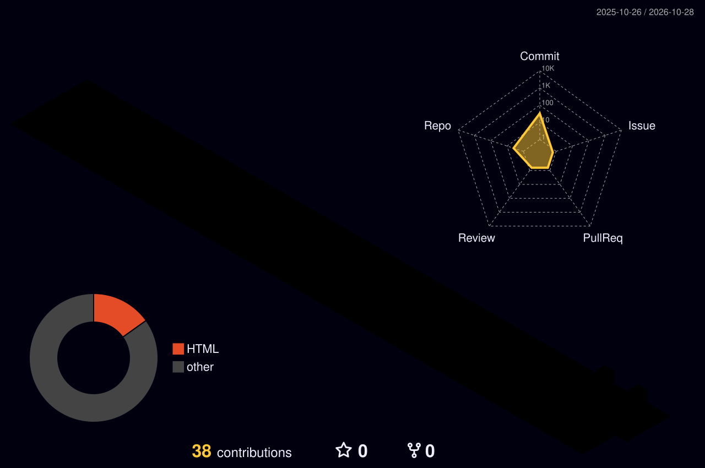

 

  

---

## 👤 About Me

I work in **BIM technology** and build tools that remove repetitive work from Revit workflows.
Right now I'm developing **BIMSheetPro**, my own batch sheet export add-in for Revit.

- 🔭 Currently building: **BIMSheetPro** (Revit 2024, C# + WPF)
- 🧰 Also exploring: AI-assisted BIM workflows (SketchUp + Claude via MCP)
- 🎯 Focus: automation, productivity tools, clean UI for Revit add-ins

---

## 🔧 Projects

<table>
<tr>
<td width="50%" valign="top">

### 📐 [BIMSheetPro](https://github.com/sathihs0023-cloud/BIMSheetPro)
Batch sheet export add-in for Revit 2024.

`PDF` `DWG` `DGN` `DWF` `NWC` `IFC` `IMG`

**Stack:** C# · WPF · Revit API
**Status:** 🚧 In development

</td>
<td width="50%" valign="top">

### 🤖 [sketchup-mcp-setup](https://github.com/sathihs0023-cloud/sketchup-mcp-setup)
Connect SketchUp 2026 to Claude Desktop using MCP.

`SketchUp` `MCP` `Claude` `AI`

**Stack:** Ruby · MCP
**Status:** ✅ Working setup guide

</td>
</tr>
</table>

---

## 🛠 Tech Stack

**BIM tools:** Revit · Revit API · Dynamo · Navisworks · SketchUp

---

## 🧊 My Contributions in 3D

---

## 📫 Let's Connect

