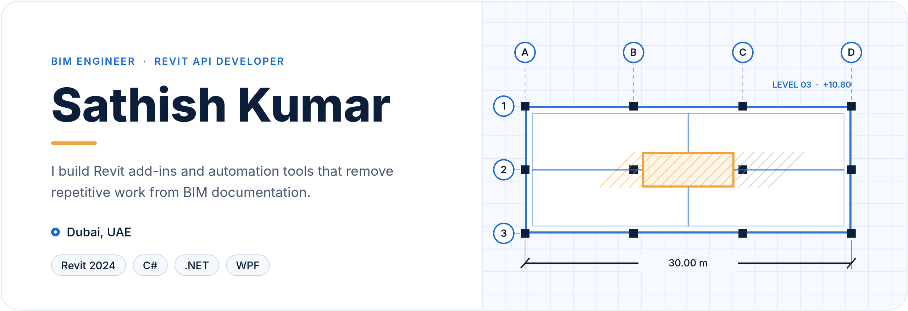
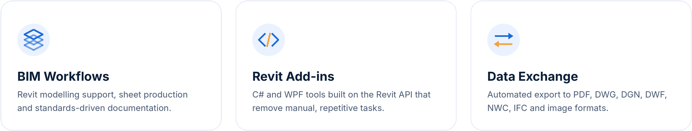
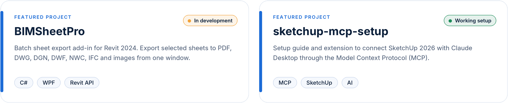
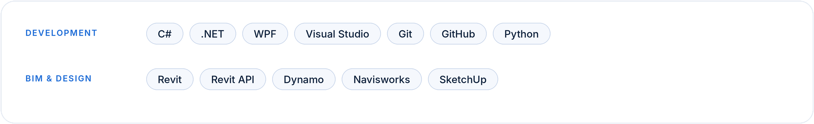

 

 

  <a href="https://github.com/sathihs0023-cloud/BIMSheetPro"><b>BIMSheetPro →</b></a>
  &nbsp;&nbsp;·&nbsp;&nbsp;
  <a href="https://github.com/sathihs0023-cloud/sketchup-mcp-setup"><b>sketchup-mcp-setup →</b></a>

  
  

